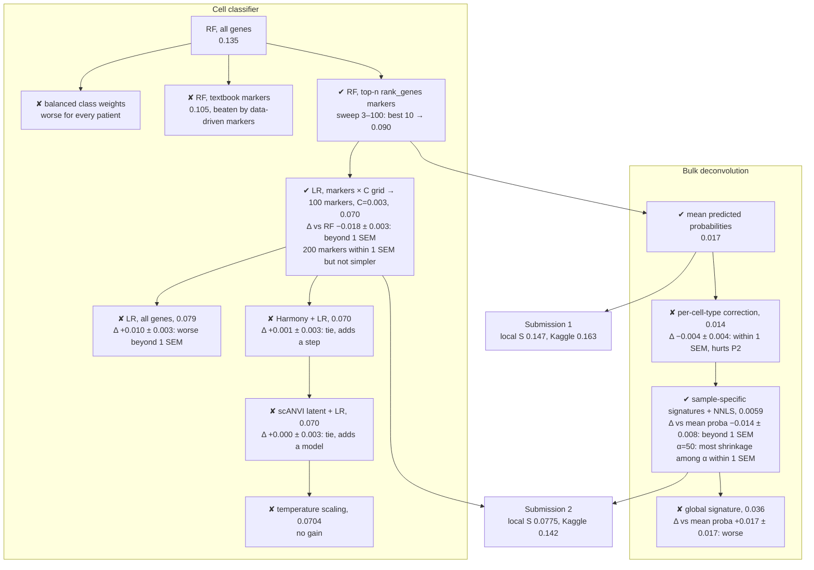

# Journal

Findings and how to reproduce them. All commands run from the repo root; data in `data/`.

## Setup

- **Validation:** leave-one-patient-out CV over the 5 training patients (P1–P4, P7; `StratifiedGroupKFold` grouped by `patient`). Test patients (P5, P6, P8) are unseen, so random cell splits overestimate.
- **Metric:** task Brier score (sum over 9 cell types of squared errors), pooled over all cells (single-cell) or bulk replicates. Competition score S = ½ B_cell/B0_cell + ½ B_bulk/B0_bulk; pass at S ≤ 0.30144.
- **Comparing settings:** paired per-patient differences to the best setting (mean ± SEM over the 5 patients). The unpaired SEM (~0.015) mostly reflects P2 being hard. RF sweep values are pooled only (no per-patient cache).
- **Features:** log1p(counts per 10k). Marker genes = top n per cell type from scanpy `rank_genes_groups`, picked inside each fold on training cells only.

## Timeline

Order in which things were tried (✔ kept, ✘ dropped; numbers: pooled B_cell, B_bulk, or local S; Δ = paired change vs the incumbent ± SEM over patients).

**Decision rule (paired one-SE rule):** a new setting replaces the incumbent only if it is better by more than one paired SEM. Among settings within one SEM of the best, keep the simplest or most regularized one. Ties therefore go to the simpler model.



## Reproduce

```
uv sync
uv run python -m ml4g_project2.predict        # local CV score S + results/submission.csv
uv run python -m ml4g_project2.sc_classify    # RF CV (single-cell Brier)
uv run python -m ml4g_project2.diagnostics    # current model: plots/cv_errors.png, marker dot plots
uv run python -m ml4g_project2.sweep_markers  # RF marker sweep (historical), plots/sweep_markers.png
uv run python -m ml4g_project2.bulk_check     # current model: sc estimate vs bulk, plots/bulk_check.png

mkdir -p experiments/out/cache                # experiment outputs (git-ignored)
uv run python experiments/lr_grid.py          # LR markers x C grid (~15 min)
uv run python experiments/lr_diag.py          # LR 200/500 markers
uv run python experiments/lr_allgenes.py      # LR on all genes
uv run python experiments/plot_lr_sweep.py    # plots/sweep_lr.png from the LR CSVs
uv run python experiments/temperature.py      # temperature scaling
uv run python experiments/bulk_correction.py  # per-cell-type bulk correction
uv run python experiments/bulk_nnls.py        # signature + NNLS deconvolution (needs lr100_oof.npy from temperature.py)
uv run --with harmonypy==2.1.0 python experiments/harmony_exp.py
uv run --with scvi-tools==1.5.2 python experiments/scanvi_exp.py       # MPS, ~10 min
uv run --with scvi-tools==1.5.2 python experiments/scanvi_allgenes.py  # MPS
```

Embeddings and per-cell CV probabilities are cached in `experiments/out/` and reused when folds and genes match. On Apple GPU (MPS) run only one scANVI script at a time: two concurrent runs deadlocked.

## Data findings

- 21,198 train / 12,264 test cells, 7,725 genes; 83% zeros. Test bulk samples come from the same samples as the test cells.
- UMAP: cell types form clean clusters, but split by patient within types. Patient and chemo status are confounded (each patient is all-pre or all-post).
- Cell-cycle markers are mostly missing from the panel (16/43 S, 20/54 G2M genes) → phase calls are noise.
- **"Myofibroblasts" are mislabelled-looking:** in P2, P4, P7 they express T cell markers (CD3D, CD2, TRAC, IL7R in ~50–57% of cells) and ACTA2 in only 11% (fibroblasts: 34%). In P3 they look like fibroblasts. P2 holds 172 of 343 myofibroblasts and 523 of 734 mast cells, which makes it the hardest patient.
- Low-depth cells err slightly more (lowest quintile 6.4% vs ~4%), mostly because T/NK/myofibroblasts have the lowest counts.

## Cell-type classifier

### Random forest
- All genes: pooled Brier 0.135. P2 worst (0.218): 163 of 172 myofibroblasts → T cells, half the NK cells → T cells.
- `class_weight="balanced"`: worse for every patient (mean over folds 0.143 → 0.180). Not used.
- Textbook markers (48 genes, `canonical_markers.yaml`): 0.105. Data-driven markers are better because they separate the labels as given.
- Marker count sweep (pooled Brier):

| Markers per type | 3 | 5 | **10** | 20 | 50 | 100 | all |
|---|---|---|---|---|---|---|---|
| RF | 0.101 | 0.092 | **0.090** | 0.095 | 0.100 | 0.104 | 0.135 |

### Logistic regression (multinomial, per-gene scaling; `make_lr`)

| Markers \ C | 0.001 | 0.003 | 0.01 | 0.03 | 0.1 | 0.3 | 1 |
|---|---|---|---|---|---|---|---|
| 3 | 0.152 | 0.125 | 0.109 | 0.100 | 0.095 | 0.095 | 0.097 |
| 5 | 0.130 | 0.107 | 0.090 | 0.084 | 0.083 | 0.084 | 0.088 |
| 10 | 0.110 | 0.092 | 0.083 | 0.081 | 0.082 | 0.084 | 0.088 |
| 20 | 0.095 | 0.082 | 0.079 | 0.083 | 0.089 | 0.095 | 0.105 |
| 50 | 0.086 | 0.078 | 0.078 | 0.083 | 0.092 | 0.099 | 0.108 |
| 100 | 0.074 | **0.070** | 0.074 | 0.082 | 0.090 | 0.099 | 0.109 |
| 200 | 0.072 | 0.070 | | | | | |
| 500 | 0.073 | 0.074 | | | | | |
| all (7,725) | 0.079 | 0.079 | 0.081 | | | | |

- Optimum on a diagonal: more genes need smaller C, levelling off at C ≈ 0.003 from ~50 markers. Peak at 100–200 markers; all genes is worse for every patient (+0.010 ± 0.003).
- **Chosen: LR, 100 markers per type (~765 genes), C = 0.003** (pooled 0.0702; per-patient mean 0.077 ± 0.015). Paired one-SE rule: only 200 markers at C = 0.003 is within one SEM (+0.0009 ± 0.0016), and it is not simpler.

| Held-out patient | RF, 10 markers | LR, 100 markers, C = 0.003 |
|---|---|---|
| P1 | 0.080 | 0.055 |
| P2 | 0.147 | 0.133 |
| P3 | 0.085 | 0.071 |
| P4 | 0.086 | 0.075 |
| P7 | 0.077 | 0.050 |
| **Pooled** | **0.090** | **0.070** (−22%) |
| Paired change (± SEM) | | −0.018 ± 0.003, better for 5/5 |

### Batch correction and other attempts (vs chosen LR, 0.0702)

| Approach | Pooled B_cell | Paired change (± SEM) |
|---|---|---|
| PCA (50) on markers + LR, C = 0.1 | 0.081 | +0.013 ± 0.007 |
| Harmony (batch = sample) + LR, C = 0.1 | 0.0699 (tie) | +0.001 ± 0.003 |
| Harmony (batch = patient) + LR, C = 0.1 | 0.0716 | +0.003 ± 0.003 |
| Harmony (sample) + RF | 0.088 | +0.018 ± 0.003 |
| scANVI (markers), own predictions | 0.193 (overconfident) | +0.143 ± 0.050 |
| scANVI (markers) latent + LR, C = 1 | 0.0703 (tie) | +0.000 ± 0.003 |
| scANVI (markers) latent + RF | 0.097 | +0.026 ± 0.005 |
| scANVI (all genes) latent + LR, C = 1 | 0.077 | +0.006 ± 0.003 |
| Temperature scaling of chosen LR (T ≈ 0.93) | 0.0704 (no gain) | n/a (not cached per patient) |

In-fold marker selection already removes most patient effects; batch correction ties at best. RF is worse than LR on every embedding. The remaining error is most likely the myofibroblast/T and NK/T label overlap, not batch effects.

## Bulk deconvolution

Validation: per held-out patient, its bulk replicates (12 in total, 2–3 per patient) are estimated from that patient's cells with out-of-fold probabilities.

### Mean predicted probabilities (first submission)

Each bulk sample = mean predicted cell-type probabilities of its sample's cells.

| Estimate (RF, 10 markers) | Bulk Brier |
|---|---|
| Mean predicted probabilities | 0.0174 |
| True single-cell labels | 0.0178 |
| Replicate vs replicate (noise) | 0.0210 |
| Argmax counts | 0.0227 |
| Constant (mean train bulk) | 0.0742 |

The classifier is not the bottleneck: the gap is single-cell vs bulk composition (T cells overestimated). LR mean probabilities are slightly worse here (0.0186).

### Per-cell-type correction (`experiments/bulk_correction.py`)

Correction fitted on the other patients' replicates: multiplicative `normalize(exp(θ)·p)` with ridge λ on θ, or additive mean offset.

Bulk Brier (paired change vs no correction ± SEM):

| Correction | RF 10 | LR 100 |
|---|---|---|
| none | 0.0174 | 0.0186 |
| additive | 0.0130 (−0.005 ± 0.005) | 0.0157 (−0.003 ± 0.007) |
| mult λ = 0 | 0.0283 (+0.013 ± 0.014) | 0.0601 (+0.037 ± 0.026) |
| mult λ = 0.01 | 0.0193 (+0.002 ± 0.007) | 0.0263 (+0.008 ± 0.011) |
| mult λ = 0.1 | **0.0139** (−0.004 ± 0.004) | 0.0177 (−0.001 ± 0.006) |
| mult λ = 1 | 0.0141 (−0.004 ± 0.002) | 0.0165 (−0.002 ± 0.002) |

Helps P1, P3, P4 but hurts P2 every time (e.g. RF 0.006 → 0.017). Superseded by NNLS.

### Sample-specific signatures + NNLS (`experiments/bulk_nnls.py`, current `predict.py`)

- Genes: top-100 markers per type (picked on training cells).
- Signature per sample: mean raw counts per cell of each type, cells weighted by predicted probabilities; shrunk towards the training-cell signature with α pseudo-cells. Coefficients then estimate cell numbers, which corrects for RNA content (plasmablasts ~5.5× T cells).
- NNLS of the bulk counts on the signature, genes scaled by 1/mean signature; normalized to proportions.

| Method | Bulk Brier | Paired change vs mean proba (± SEM) | P2 |
|---|---|---|---|
| Mean proba (LR) | 0.0186 | 0 | 0.008 |
| NNLS α = 0 | 0.0079 | −0.013 ± 0.007 | 0.015 |
| NNLS α = 10 | 0.0064 | −0.014 ± 0.008 | 0.022 |
| **NNLS α = 50 (chosen, one-SE rule)** | **0.0059** | −0.014 ± 0.008 | 0.023 |
| Blend 0.75 NNLS α=10 + 0.25 mean proba | 0.0054 | −0.015 ± 0.007 | 0.015 |
| Blend 0.5 | 0.0070 | −0.013 ± 0.005 | 0.011 |
| Global signature (all training cells) | 0.0364 | +0.017 ± 0.017 | 0.052 |
| NNLS with true labels (oracle) | 0.0027 | −0.018 ± 0.006 | 0.005 |

- Sample-specific signatures are essential: one global signature is worse than no deconvolution.
- Better for 4/5 patients, **worse for P2** (0.008 → 0.023): T, NK and "myofibroblast" profiles are nearly collinear, so NNLS trades them off.
- Same problem on test: predictions leave the training range (myofibroblasts ~0.18 in s9/s10 vs train max 0.10; NK 0.29 in s5 vs max 0.16).

## Competition score

SEMs are over the 5 per-patient values (P2: S = 0.206, others 0.04–0.09). No SEM for submission 1: P1's B0_bulk is tiny (0.017), so its per-patient S (1.02) swamps the spread.

Local CV terms are ½·B/B0 with B0 from the reference (training-fold frequencies); the task computes B0 on test rows, so local and Kaggle values are not directly comparable.

| Submission | Pipeline | Cell term | Bulk term | Local S | Kaggle |
|---|---|---|---|---|---|
| 1 (`0000e39`) | RF 10 markers + mean proba | 0.063 | 0.084 | 0.147 | 0.163 |
| 2 (`868764c`, current) | LR 100, C = 0.003 + NNLS α = 50 | 0.049 ± 0.012 | 0.028 ± 0.019 | 0.0775 ± 0.029 | 0.142 |

The cell-model change alone predicts ~−0.014 of the −0.021 gain, so NNLS likely gave little on test, consistent with test samples behaving like P2. Candidate hedges: 75/25 blend with mean probabilities; grouping T/NK/myofibroblasts in the NNLS and splitting by sc proportions.
